# Olá, eu sou Otávio Araújo! 👋

### Estudante de Informática para Internet · Desenvolvedor em formação

## 👨‍💻 Sobre mim

Sou estudante do Ensino Médio Integrado ao Técnico em Informática para Internet no IFRN. Gosto de aprender construindo projetos e transformar ideias em soluções úteis. Tenho interesse em desenvolvimento web, programação, automação e criação de produtos digitais.

## 🎓 Formação e aprendizado

- **Ensino Médio Integrado ao Técnico em Informática para Internet** — IFRN *(em andamento)*
- **Projetos de estudo:** exercícios em Python e projetos web no repositório [InfoAulas](https://github.com/ottavioaraujo/infoaulas).

## 🧰 Tecnologias

Tecnologias que uso e estudo:

  
  
  
  
  
  
  
  
  
  
  

## 🚀 Projeto em destaque

### [Achados e Perdidos do IF](https://github.com/ottavioaraujo/entre-nos-achados-if)

Projeto para ajudar a comunidade do IFRN a divulgar e encontrar itens perdidos.

### [OttavioAgent](https://github.com/ottavioaraujo/OttavioAgent)

Agente desenvolvido para explorar aplicações de inteligência artificial.

### [InfoAulas](https://github.com/ottavioaraujo/infoaulas)

Repositório de estudos com exercícios em Python e projetos de desenvolvimento web usando HTML, CSS e JavaScript.

## 📊 GitHub

  
  

  
  

## 🎮 Contribuições em Pac-Man

<picture>
  <source media="(prefers-color-scheme: dark)" srcset="https://raw.githubusercontent.com/ottavioaraujo/ottavioaraujo/pacman-output/pacman-contribution-graph-dark.svg">
  <source media="(prefers-color-scheme: light)" srcset="https://raw.githubusercontent.com/ottavioaraujo/ottavioaraujo/pacman-output/pacman-contribution-graph.svg">
  
</picture>

## 📫 Contato

✉️ [otavio.araujo@escolar.ifrn.edu.br](mailto:otavio.araujo@escolar.ifrn.edu.br)

---

Obrigado por visitar meu perfil! ✨

