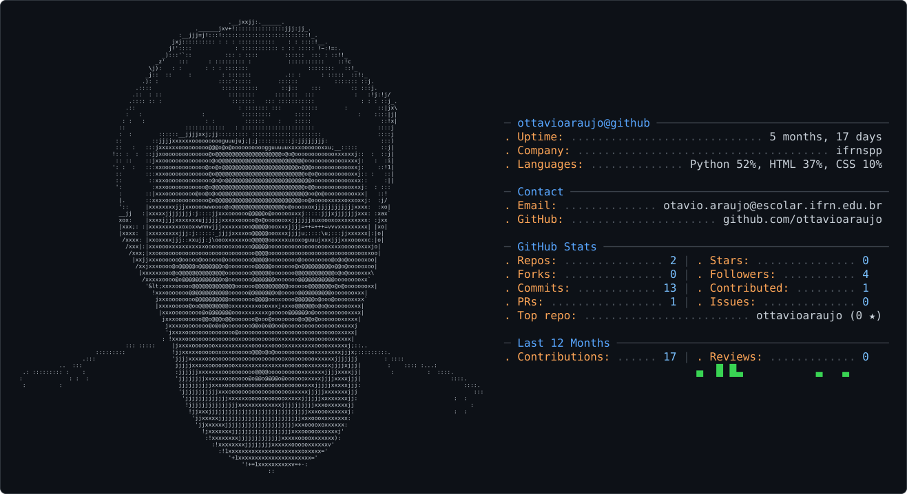

<picture>
  <source media="(prefers-color-scheme: dark)" srcset="dark_mode.svg" />
  <source media="(prefers-color-scheme: light)" srcset="light_mode.svg" />
  
</picture>

# Olá, eu sou Otávio Araújo! 👋

### Estudante de Informática para Internet · Desenvolvedor em formação

## 👨‍💻 Sobre mim

Sou estudante do Ensino Médio Integrado ao Técnico em Informática para Internet no IFRN. Gosto de aprender construindo projetos e transformar ideias em soluções úteis. Tenho interesse em desenvolvimento web, programação, automação e criação de produtos digitais.

## 🎓 Formação e aprendizado

- **Ensino Médio Integrado ao Técnico em Informática para Internet** — IFRN *(em andamento)*
- **Prática de programação:** atividades e projetos de estudo em Python e desenvolvimento web no repositório [InfoAulas](https://github.com/ottavioaraujo/infoaulas).

## 🧰 Tecnologias

Tecnologias que uso e estudo:

  
  
  
  
  
  
  
  
  
  
  

## 🚀 Projetos em destaque

### [InfoAulas](https://github.com/ottavioaraujo/infoaulas)

Repositório de estudos e atividades práticas, com exercícios em Python e projetos de desenvolvimento web usando HTML, CSS e JavaScript.

### [Portfólio do GitHub](https://github.com/ottavioaraujo/ottavioaraujo)

Este perfil reúne meus estudos, projetos e experimentos. O cartão do topo alterna entre os temas claro e escuro.

## 📊 Estatísticas do GitHub

  
  

  
  

## 🎮 Gráfico de contribuições Pac-Man

<picture data-importer="pacman">
  <source media="(prefers-color-scheme: dark)" srcset="https://raw.githubusercontent.com/ottavioaraujo/ottavioaraujo/pacman-output/pacman-contribution-graph-dark.svg">
  <source media="(prefers-color-scheme: light)" srcset="https://raw.githubusercontent.com/ottavioaraujo/ottavioaraujo/pacman-output/pacman-contribution-graph.svg">
  
</picture>

## 📫 Contato

  
  
  

✉️ <a href="mailto:otavio.araujo@escolar.ifrn.edu.br">otavio.araujo@escolar.ifrn.edu.br</a>

---

Obrigado por visitar meu perfil! ✨

